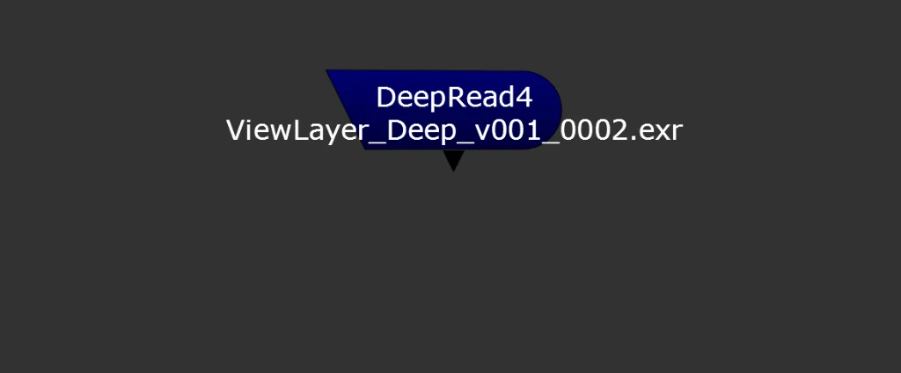
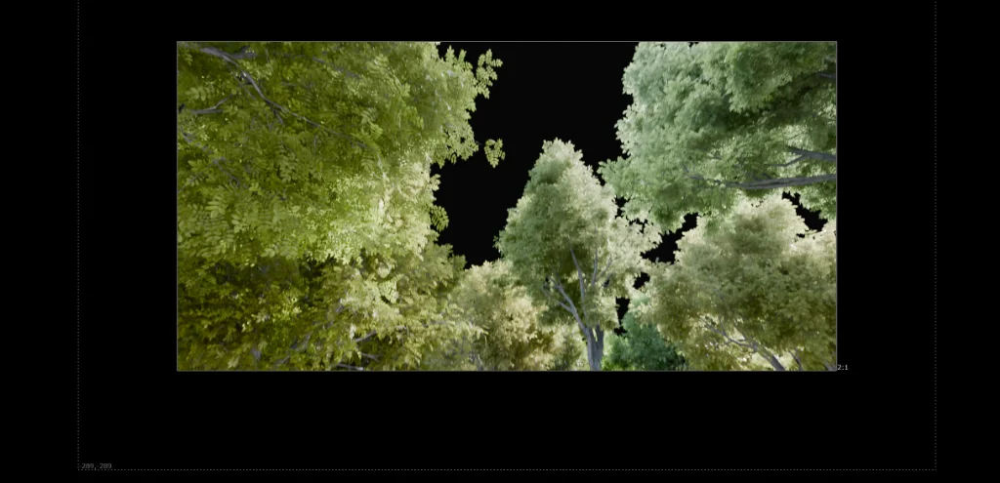
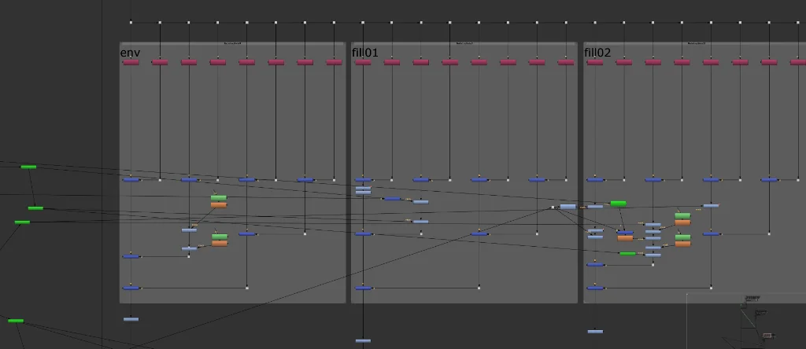
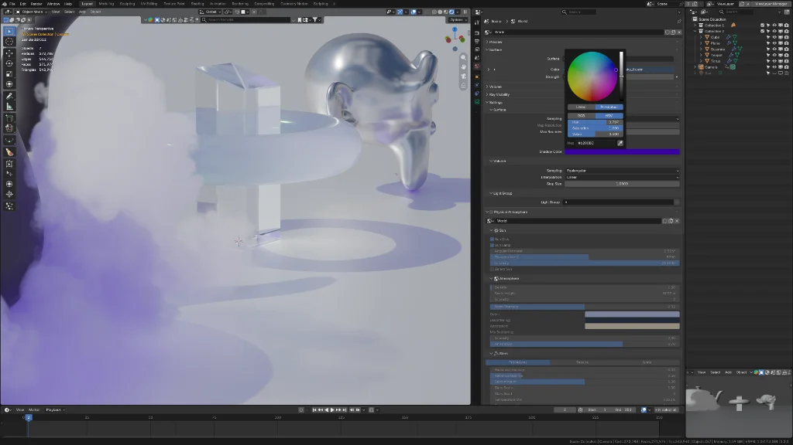
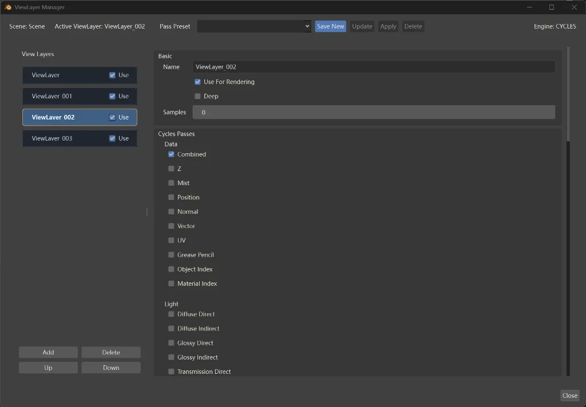

<!--
Keep this document short and link to the public documentation site for details.
See release/text/readme.html for packaged end-user notes.
-->

# Industrial CG Platform

  

  <a href="https://cgweave.com/en/industrial-cg-platform/">Website</a>
  ·
  <a href="README.zh-CN.md">简体中文</a>
  ·
  <a href="https://cgweave.com/zh/industrial-cg-platform/">中文官网</a>
  ·
  <a href="https://cgweave.com/fr/industrial-cg-platform/">Français</a>
  ·
  <a href="https://github.com/RolandVyens/industrial-cg-platform/releases">Releases</a>

  

  <strong>Built for VFX. Built from Blender. Built for shots.</strong> 
  A Blender-based production platform for advanced VFX workflows.

  <a href="https://cgweave.com/en/industrial-cg-platform/guide/getting-started">Getting Started</a>
  ·
  <a href="https://cgweave.com/en/industrial-cg-platform/features/deep-exr">Features</a>
  ·
  <a href="https://cgweave.com/en/industrial-cg-platform/api/">API Reference</a>
  ·
  <a href="https://cgweave.com/en/industrial-cg-platform/releases/">Release Notes</a>

## Platform Highlights

Industrial CG Platform is the Blender VFX rendering branch for shot-based production work.
The current public documentation is maintained on the CGWeave Industrial 3D site.

<table>
  <tr>
    <td width="180" align="center" valign="middle">
      
    </td>
    <td valign="middle">
      <h3><a href="https://cgweave.com/en/industrial-cg-platform/features/deep-exr">Deep EXR Output</a></h3>
      
Native Deep EXR output for Cycles on CPU and OptiX, for deep compositing in Nuke and other tools.

    </td>
  </tr>
  <tr>
    <td width="180" align="center" valign="middle">
      
    </td>
    <td valign="middle">
      <h3><a href="https://cgweave.com/en/industrial-cg-platform/features/exr-overscan">EXR Overscan</a></h3>
      
Native EXR overscan support in Cycles, rendering extra pixels outside the camera frame for lens distortion, camera shake, and image transformations.

    </td>
  </tr>
  <tr>
    <td width="180" align="center" valign="middle">
      
    </td>
    <td valign="middle">
      <h3><a href="https://cgweave.com/en/industrial-cg-platform/features/lightgroup-lobe-passes">Lightgroup Lobe Passes</a></h3>
      
Per-lightgroup diffuse, glossy, transmission, and volume passes with direct and indirect separation for fine-grained relighting control.

    </td>
  </tr>
  <tr>
    <td width="180" align="center" valign="middle">
      
    </td>
    <td valign="middle">
      <h3><a href="https://cgweave.com/en/industrial-cg-platform/features/shadow-color">Shadow Color</a></h3>
      
Artistic per-light and per-world shadow color control, tinting shadows without affecting the rest of the lighting.

    </td>
  </tr>
  <tr>
    <td width="180" align="center" valign="middle">
      
    </td>
    <td valign="middle">
      <h3><a href="https://cgweave.com/en/industrial-cg-platform/features/viewlayer-manager">ViewLayer Manager</a></h3>
      
Qt-based ViewLayer management with presets, pass grouping, and batch ViewLayer operations from a dedicated manager window.

    </td>
  </tr>
</table>

## Documentation

- [User Guide](https://cgweave.com/en/industrial-cg-platform/guide/getting-started)
- [Features Reference](https://cgweave.com/en/industrial-cg-platform/features/deep-exr)
- [API Reference](https://cgweave.com/en/industrial-cg-platform/api/)
- [Release Notes](https://cgweave.com/en/industrial-cg-platform/releases/)
- [Development Tracking](https://cgweave.com/en/feature-tracking)
- [Industrial 3D Ecosystem](https://cgweave.com/en/)

## Repository Notes

This repository is the public continuation branch for Industrial CG Platform.
For source builds, start with Blender's upstream build documentation and build this repository so the Industrial CG Platform rendering and UI changes are included.

- [Blender Build Instructions](https://developer.blender.org/docs/handbook/building_blender/)
- [Blender Developer Documentation](https://developer.blender.org/docs/)

## Support the Development

Industrial CG Platform is developed as production-focused open-source R&D.

- [Support on Patreon](https://www.patreon.com/cw/RolandVyens)
- [Support on Afdian](https://www.ifdian.net/a/mogubobi2)

## License

Released under the Blender License, GNU GPL v3 or later.
Bundled third-party runtime components keep their own upstream license notices in the repository.

Copyright (C) 2026 RolandVyens
