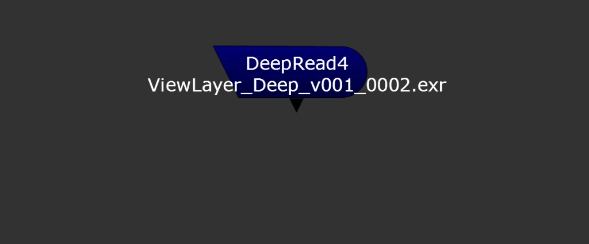
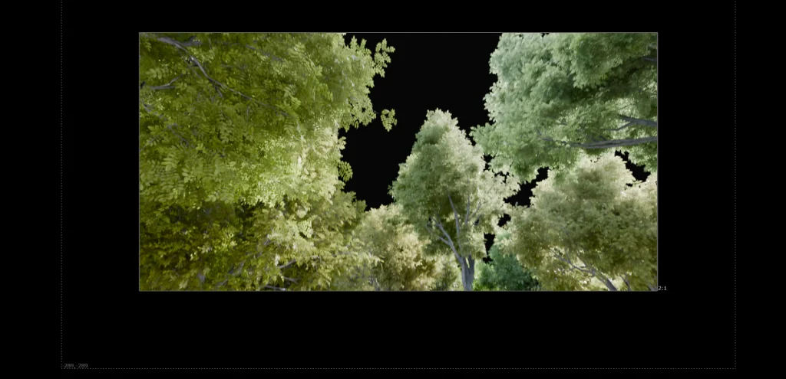
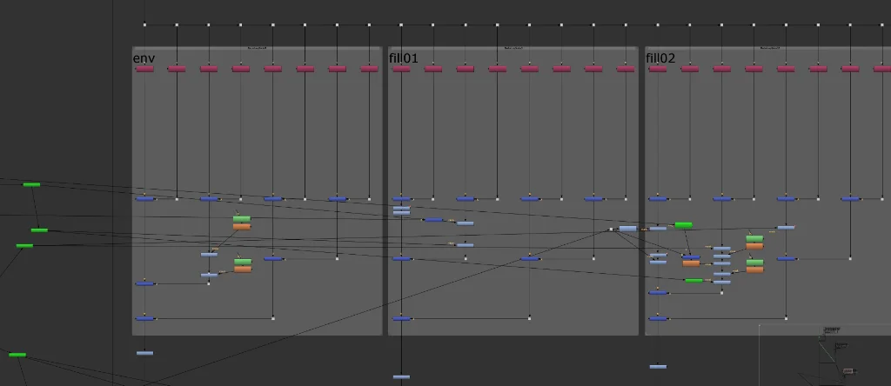
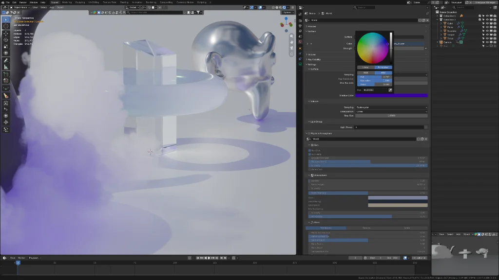
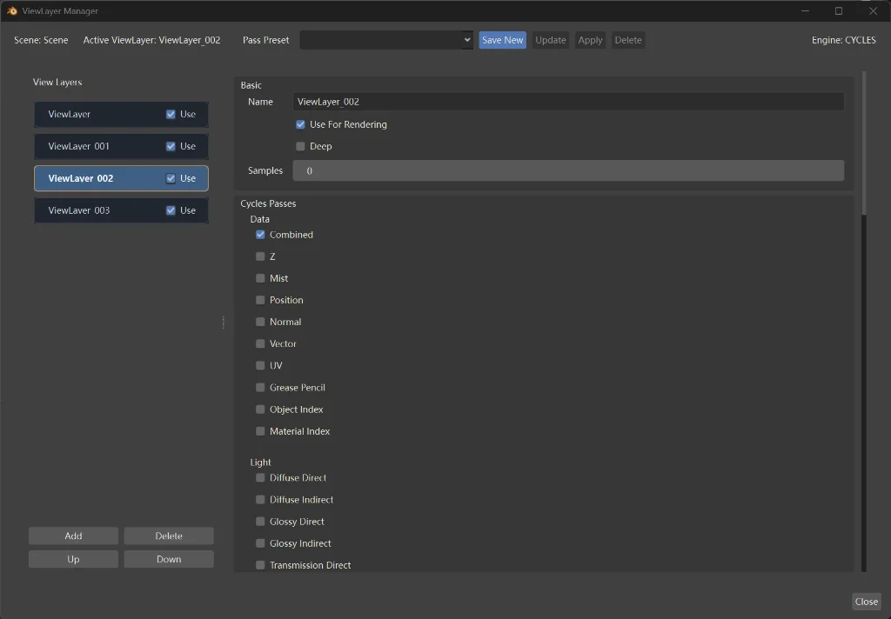

<!--
Keep this document short and link to the public documentation site for details.
See release/text/readme.html for packaged end-user notes.
-->

# Industrial CG Platform

  

  <a href="README.md">English README</a>
  ·
  <a href="https://cgweave.com/zh/industrial-cg-platform/">中文官网</a>
  ·
  <a href="https://cgweave.com/en/industrial-cg-platform/">English</a>
  ·
  <a href="https://cgweave.com/fr/industrial-cg-platform/">Français</a>
  ·
  <a href="https://github.com/RolandVyens/industrial-cg-platform/releases">版本发布</a>

  

  <strong>专为 VFX 打造。源于 Blender。为镜头而生。</strong> 
  基于 Blender 的高级 VFX 工作流生产平台。

  <a href="https://cgweave.com/zh/industrial-cg-platform/guide/getting-started">快速开始</a>
  ·
  <a href="https://cgweave.com/zh/industrial-cg-platform/features/deep-exr">功能</a>
  ·
  <a href="https://cgweave.com/zh/industrial-cg-platform/api/">API 参考</a>
  ·
  <a href="https://cgweave.com/zh/industrial-cg-platform/releases/">版本发布记录</a>

## 平台重点

Industrial CG Platform 是面向镜头生产的 Blender VFX 渲染分支。
当前公开文档维护在 CGWeave Industrial 3D 网站。

<table>
  <tr>
    <td width="180" align="center" valign="middle">
      
    </td>
    <td valign="middle">
      <h3><a href="https://cgweave.com/zh/industrial-cg-platform/features/deep-exr">Deep EXR 深度输出</a></h3>
      
Cycles 原生 Deep EXR 输出，支持 CPU／OptiX，用于 Nuke 等工具中的深度合成。

    </td>
  </tr>
  <tr>
    <td width="180" align="center" valign="middle">
      
    </td>
    <td valign="middle">
      <h3><a href="https://cgweave.com/zh/industrial-cg-platform/features/exr-overscan">EXR Overscan 溢画幅</a></h3>
      
Cycles 原生 EXR 溢画幅支持，在相机框外计算额外像素边缘，为镜头防抖、去畸变和图像变形提供缓冲。

    </td>
  </tr>
  <tr>
    <td width="180" align="center" valign="middle">
      
    </td>
    <td valign="middle">
      <h3><a href="https://cgweave.com/zh/industrial-cg-platform/features/lightgroup-lobe-passes">灯光组分量通道</a></h3>
      
逐灯光组的漫反射、光泽、透射、体积分量通道，支持直接光和间接光分离，实现精细重打光控制。

    </td>
  </tr>
  <tr>
    <td width="180" align="center" valign="middle">
      
    </td>
    <td valign="middle">
      <h3><a href="https://cgweave.com/zh/industrial-cg-platform/features/shadow-color">阴影颜色</a></h3>
      
美术级逐灯光和逐世界阴影颜色控制，为阴影着色而不影响其余照明。

    </td>
  </tr>
  <tr>
    <td width="180" align="center" valign="middle">
      
    </td>
    <td valign="middle">
      <h3><a href="https://cgweave.com/zh/industrial-cg-platform/features/viewlayer-manager">ViewLayer 管理器</a></h3>
      
基于 Qt 的 ViewLayer 管理工具，提供预设系统、通道分组和批量 ViewLayer 操作。

    </td>
  </tr>
</table>

## 文档入口

- [用户指南](https://cgweave.com/zh/industrial-cg-platform/guide/getting-started)
- [功能介绍](https://cgweave.com/zh/industrial-cg-platform/features/deep-exr)
- [API 参考手册](https://cgweave.com/zh/industrial-cg-platform/api/)
- [版本发布记录](https://cgweave.com/zh/industrial-cg-platform/releases/)
- [开发追踪](https://cgweave.com/zh/feature-tracking)
- [Industrial 3D 开源生态](https://cgweave.com/zh/)

## 仓库说明

这个仓库是 Industrial CG Platform 的公开 continuation 分支。
如果需要从源码构建，请先参考 Blender 上游构建文档，并构建本仓库以包含 Industrial CG Platform 的渲染与 UI 改动。

- [Blender Build Instructions](https://developer.blender.org/docs/handbook/building_blender/)
- [Blender Developer Documentation](https://developer.blender.org/docs/)

## 支持与赞助开发

Industrial CG Platform 是作为专注于生产的开源研发项目进行开发的。

- [在 Patreon 上支持](https://www.patreon.com/cw/RolandVyens)
- [在爱发电上支持](https://www.ifdian.net/a/mogubobi2)

## 许可

Released under the Blender License, GNU GPL v3 or later.
仓库中打包的第三方运行时组件保留各自的上游许可声明。

Copyright (C) 2026 RolandVyens
